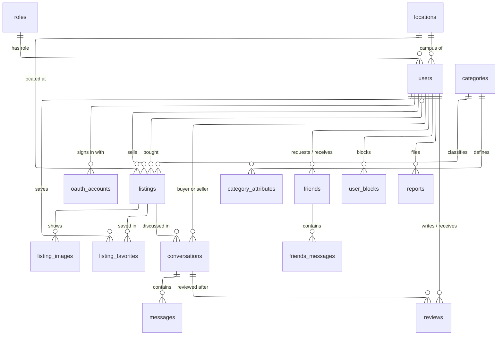

*This project has been created as part of the 42 curriculum by flomulle, iargence, lmilando, mzouhir, nfenollo.*

# Le Bon 42

**The classifieds platform for 42 students.** Sell what you no longer need,
offer tutoring or a ride, find a room, and chat with other students, all
with your 42 account.

## Contents

- [Le Bon 42](#le-bon-42)
  - [Contents](#contents)
  - [Description](#description)
    - [Key features](#key-features)
  - [Instructions](#instructions)
    - [Prerequisites](#prerequisites)
    - [Configuration](#configuration)
    - [Running the project](#running-the-project)
    - [Everyday commands](#everyday-commands)
    - [Addresses](#addresses)
    - [Running the tests](#running-the-tests)
  - [Resources](#resources)
    - [References](#references)
    - [Use of AI](#use-of-ai)
  - [Team Information](#team-information)
  - [Project Management](#project-management)
  - [Technical Stack](#technical-stack)
    - [Front end](#front-end)
    - [Back end](#back-end)
    - [Database: PostgreSQL 18](#database-postgresql-18)
    - [Other significant technologies](#other-significant-technologies)
    - [Justification of the major choices](#justification-of-the-major-choices)
  - [Database Schema](#database-schema)
  - [Features List](#features-list)
  - [Modules](#modules)
    - [Summary](#summary)
    - [Point calculation](#point-calculation)
    - [Details](#details)
  - [Individual Contributions](#individual-contributions)
    - [flomulle](#flomulle)
    - [iargence](#iargence)
    - [lmilando](#lmilando)
    - [mzouhir](#mzouhir)
    - [nfenollo](#nfenollo)
  - [Documentation](#documentation)
  - [Known Limitations](#known-limitations)
  - [License](#license)

---

## Description

**Le Bon 42** is our `ft_transcendence` project: a classifieds and mutual-aid
website reserved for 42 students, in the spirit of Leboncoin.

**Goal.** Students on a campus constantly exchange things: furniture when
they move, lessons before an exam, a seat in a car, a room to rent. Le Bon 42
gives these exchanges one trusted place, where everyone is a verified 42
student and where bad behaviour can be reported and moderated.

**Overview.** The application is a Next.js front and a FastAPI back end over
PostgreSQL, behind an nginx reverse proxy that serves everything over HTTPS
from a single address. Messages, typing indicators and online status are
pushed in real time over a WebSocket. Prometheus and Grafana monitor the
service. The whole stack starts with one command.

### Key features

- **Sign in with 42, or with email and password**: the 42 login proves you are
  a student; a local email/password account is also supported.
- **Listings**: post objects, lessons, rides, services or housing; search
  them by keyword, campus, category and price; sort and save favorites.
- **Buyer–seller chat**: contact a seller from a listing, mark the item as
  sold, then review each other.
- **Friends and direct messages**, with live delivery, typing indicators and
  online status.
- **Profiles and personal statistics**: what you sell, sold and bought.
- **Safety**: block users; report listings, messages, users and reviews.
- **Moderation and administration**: a report queue for moderators, role and
  account management for admins.
- **Analytics dashboard** for admins, with charts, live updates and PDF export.
- **Monitoring**: Grafana dashboards and Prometheus alerts.

The complete list is in [Features List](#features-list).

---

## Instructions

### Prerequisites

| Software | Version | Needed for |
|---|---|---|
| Docker Engine with the Compose plugin (`docker compose`) | Compose v2 or later | Running the application |
| *or* Podman with podman-compose | Rootless works; tested with podman-compose 1.6 | Running the application on 42 computers |
| GNU make | Any recent version | The commands below |
| openssl | Any recent version | Generating secrets on the first run |
| A 42 intra account | — | Creating the OAuth application that enables sign-in |
| [uv](https://docs.astral.sh/uv/) | Recent; it installs Python 3.14 itself | Back-end tests only |
| Node.js and npm | Node 22 | Browser tests only |

Free ports on the host, with the default configuration: **8443** (HTTPS),
**8080** (HTTP, redirects to HTTPS), and **5432** (PostgreSQL, development mode only).

### Configuration

Two kinds of configuration live at the repository root. The first run creates
both for you.

**`.env`**, copied from [`.env.example`](.env.example). It holds non-secret
settings:

| Variable | Default | Meaning |
|---|---|---|
| `SERVER_NAME` | `localhost` | Host name the site is served on |
| `HTTP_PORT` / `HTTPS_PORT` | `8080` / `8443` | Host ports. Rootless Podman cannot use ports below 1024 |
| `ENVIRONMENT` | empty (`dev`) | Set to `prod` on a real deployment |
| `POSTGRES_DB`, `POSTGRES_HOST`, `POSTGRES_PORT` | `lb42db`, `db`, `5432` | Database location |
| `SEED_DEMO_DATA` | `true` | Load the demo data on the first start. Set to `false` on a real deployment |

**`secrets/`**, one file per secret, never committed:

| File | Content |
|---|---|
| `POSTGRES_USER`, `POSTGRES_PASSWORD` | Database credentials: `lb42` and a generated password |
| `SECRET_KEY` | Signs the session cookies, generated |
| `GRAFANA_USER`, `GRAFANA_PASSWORD` | Grafana administrator: `lb42` and a generated password. Read them from these files to sign in at `/grafana/` |
| `FT_CLIENT_ID`, `FT_CLIENT_SECRET` | Your 42 OAuth application's UID and secret, asked for on the first run |

Every setting is documented in the
[back-end README](backend/README.md#configuration).

### Running the project

1. **Clone the repository** and open a terminal at its root.

2. **Start the application:**

   ```bash
   make up
   ```

   The first run builds the images, which takes a few minutes. It creates
   `.env` and `secrets/`, then asks for the two 42 credentials: press
   **Enter** to skip them for now. Everything works except signing in.

3. **Open <https://localhost:8443>.** Your browser warns about the
   certificate, because the local one is self-signed: accept it. Demo
   listings, users and conversations are already loaded.

4. **Enable "Sign in with 42":**
   1. create an application on
      <https://profile.intra.42.fr/oauth/applications>, with this redirect
      URI, exactly: `https://localhost:8443/api/auth/callback`;
   2. paste its UID into `secrets/FT_CLIENT_ID` and its secret into
      `secrets/FT_CLIENT_SECRET`;
   3. restart: `make down`, then `make dev`.

5. **Stop** with `Ctrl+C`, or `make down` from another terminal. Your data is
   kept for the next start.

**Accounts and roles.** The demo data pre-creates the five team accounts with
their roles (`nfenollo`, `iargence`, `mzouhir`: admin; `flomulle`: moderator;
`lmilando`: user). They have no password: each member's first 42 login links
to theirs and keeps the role. Any other account, from 42 or from the email and
password form, starts as `user`; an admin can then change its role from the
*Moderation* page. To promote a first account without an admin, see the
[back-end troubleshooting](backend/README.md#troubleshooting).

### Everyday commands

| Command | What it does |
|---|---|
| `make dev` | Start everything in development mode: live reload, demo data |
| `make up`, or a bare `make` | Start everything in the background, in production mode |
| `make down` | Stop everything. Data is kept |
| `make logs` / `make ps` | Follow the logs / list the services |
| `make clean` | Stop everything and **delete all data**, database included |

`make dev` and `make up` both build what changed, create the missing
configuration, then start the stack: one command either way.

### Addresses

| Address | What you find |
|---|---|
| <https://localhost:8443> | The application |
| <https://localhost:8443/api/v1/docs> | Interactive API documentation (Swagger UI), in development mode |
| <https://localhost:8443/grafana/> | Monitoring dashboards. Prometheus is internal only: query it and see its alerts from Grafana's *Explore* |

### Running the tests

| Suite | Command | Details |
|---|---|---|
| Back end (API, database, real-time) | `make test`, from the root. Uses a throwaway database | [Back-end README](backend/README.md#testing) |
| Browser tests (Chromium, Firefox, WebKit) | In `front/`, with `make dev` running: `npm ci`, `npx playwright install` once, then `npx playwright test` | [`front/BROWSERS.md`](front/BROWSERS.md) |

---

## Resources

### References

| Topic | Resource |
|---|---|
| Front | [Next.js documentation](https://nextjs.org/docs), [React documentation](https://react.dev), [Tailwind CSS](https://tailwindcss.com/docs), [Recharts](https://recharts.org) |
| Back end | [FastAPI](https://fastapi.tiangolo.com), [Pydantic](https://docs.pydantic.dev), [SQLAlchemy 2.0](https://docs.sqlalchemy.org/en/20/), [Alembic](https://alembic.sqlalchemy.org) |
| Database | [PostgreSQL documentation](https://www.postgresql.org/docs/), including [full-text search](https://www.postgresql.org/docs/current/textsearch.html) and [explicit locking](https://www.postgresql.org/docs/current/explicit-locking.html) |
| Sign-in | [42 API documentation](https://api.intra.42.fr/apidoc), [RFC 6749: OAuth 2.0](https://datatracker.ietf.org/doc/html/rfc6749) |
| Real-time | [RFC 6455: the WebSocket protocol](https://datatracker.ietf.org/doc/html/rfc6455), [MDN: Server-sent events](https://developer.mozilla.org/en-US/docs/Web/API/Server-sent_events) |
| Security | [OWASP Cheat Sheet Series](https://cheatsheetseries.owasp.org), [MDN: Content Security Policy](https://developer.mozilla.org/en-US/docs/Web/HTTP/CSP) |
| Infrastructure | [Docker Compose](https://docs.docker.com/compose/), [nginx documentation](https://nginx.org/en/docs/), [Podman](https://docs.podman.io) |
| Monitoring | [Prometheus](https://prometheus.io/docs/), [Grafana](https://grafana.com/docs/grafana/latest/) |
| Testing | [pytest](https://docs.pytest.org), [Playwright](https://playwright.dev/docs/intro) |


### Use of AI

| Task | Part of the project | Tool |
|---|---|---|
| Decision making helper: provide best practices and pros and cons for technical decisions | Strategy, documentation | Claude Code (Anthropic), Codex (OpenAI) |
| Writing and reviewing documentation against the code: the root, frontend,  backend, nginx and monitoring  | Documentation | Claude Code (Anthropic), Codex (OpenAI) |
| Code reviews | Front and Back | Claude Code (Anthropic), Codex (OpenAI) |


Every AI-produced change has been read, understood and tested by the member who committed it.

---

## Team Information

| Login | Role(s) | Responsibilities | Main areas in the code |
|---|---|---|---|
| **flomulle** | Architect, Product Owner Backend, Developer | Stack definition, DB schema design, backend features | Infrastructure (Docker, nginx, Podman), database design, analytics API, back-end hardening |
| **iargence** | Product Owner Frontend, Developer | Frontend features, validation, tracking of front tasks | Front: listings, moderation, admin and analytics pages; monitoring stack |
| **lmilando** | Technical Lead Backend, Developer | Backend technical decisions, critical code review | 42 OAuth sign-in, real-time core (server and browser client) |
| **mzouhir** | Technical Lead Frontend, Developer | Frontend technical decisions, critical code review | Front: messaging, profiles, friends, legal pages, browser tests |
| **nfenollo** | Project Manager, Developer | Team management, global overseeing, orchestration, consistency | Back end: REST API, database models and migrations, tests, limits and quotas |

Git identities: commits appear under several author names for the same people, `nathanfnl` / `Nathan Fenollosa` (nfenollo), `ismaelargence` (iargence), `roxanmlr` / `Loïc MILANDOU` (lmilando), `Mehdi` / `Mehdi Zouhir` (mzouhir) and `R-FLM` / `Florian Muller` (flomulle).

With five members, the Product Owner and Technical Lead roles are each split between the front end and the back end. The architect owns the overall design and the stack; the technical leads make day-to-day decisions within it.

---

## Project Management

**Work organization.**

- Tasks were distributed both by layer and feature, between the backend team and frontend team, depending on knowledge, affinities and interests.
- Meeting rhythm: mostly bi-weekly sync, live at 42 or on Discord.
- No real blockers were encountered: all decisions have been debated and agreed on with no friction.
- Work was split into feature branches (one per task) and merged through
  more than 50 pull requests.
- The API contract between front and back was specified in Notion, then
  implemented route by route.

**Git workflow** (details in [`CONTRIBUTING.md`](CONTRIBUTING.md)):

- `main` and `dev` are protected: changes arrive only through pull requests;
- `backend` and `front` collect day-to-day work for each side;
- task branches start from `backend`, `front` or `dev`;
- commit messages follow [Conventional Commits](https://www.conventionalcommits.org).

**Tools.**

| Tool | Used for |
|---|---|
| Notion | <ul><li>Tasks tracking</li><li>Decisions logging</li><li>Dashboards</li><li>API specification shared between front and back</li> |
| GitHub | Repository, pull requests and code reviews |
| Discord server | Communication channels, split by area for clarity and history |

---

## Technical Stack

### Front end

| Technology | Role |
|---|---|
| **Next.js 16** (App Router) | Pages, routing, server-side rendering, Server Actions |
| **React 19**, **TypeScript 5** | UI components, strict typing |
| **Tailwind CSS 4** | Styling, with the project's colour palette defined as theme tokens |
| **Recharts** | Charts of the analytics dashboard |
| **Playwright** | End-to-end tests on Chromium, Firefox and WebKit |

### Back end

| Technology | Role |
|---|---|
| **Python 3.14**, **FastAPI** | REST API, WebSocket endpoint, Server-Sent Events |
| **Pydantic 2** | Request validation, input size limits, typed settings |
| **SQLAlchemy 2** (async) over **asyncpg** | ORM and database access |
| **Alembic** | Database migrations |
| **PyJWT**, **httpx** | Session tokens, calls to the 42 API |
| **uv**, **pytest**, **ruff**, **mypy** | Dependencies, tests, lint, type checks |

### Database: PostgreSQL 18

Why PostgreSQL:

- **The data is relational.** Users, listings, conversations, messages,
  reviews, friendships and reports reference each other. Foreign keys and
  `CHECK` constraints make the database itself refuse invalid states, such as
  a self-review, a negative price or a buyer who is also the seller.
- **It covers needs that would otherwise require extra services:** `JSONB`
  for attributes that vary by category (surface of a flat, subject of a
  lesson), a `tsvector` column for full-text search, case-insensitive text
  (`CITEXT`) for emails and names, and UUID generation for public
  identifiers.
- **Row-level locks** keep per-user quotas and moderation decisions correct
  when two requests arrive at the same time.

### Other significant technologies

| Technology | Role |
|---|---|
| **nginx** | Reverse proxy: HTTPS, routing, security headers, per-IP rate limits |
| **Prometheus**, **Grafana**, **postgres-exporter** | Metrics, alerts, dashboards |
| **Docker Compose** / **Podman** | One-command start, identical on every machine |
| **42 OAuth 2.0** | Sign-in with the 42 intra, or locally with email/password |

### Justification of the major choices

| Choice | Why |
|---|---|
| Next.js | One framework for routing, server-side rendering and the build. Pages fetch their data on the server, straight from the API over the internal network |
| FastAPI | Asynchronous by design, so REST calls, WebSockets and SSE streams share one event loop. Validation and the OpenAPI documentation come from the same type declarations |
| SQLAlchemy and Alembic | Typed models in Python, and versioned migrations applied automatically at start |
| A single origin behind nginx | Front and API share one address, so cookies are first-party and no CORS is needed. TLS, headers and rate limits live in one place |
| 42 OAuth, plus optional email/password | The 42 login verifies a real student; a local email/password account is also possible. Passwords are hashed with Argon2 |
| WebSocket for users, SSE for the admin dashboard | The chat needs two-way, ordered messages that survive reconnections. The dashboard only needs a "refresh now" signal, which one-way SSE provides simply |
| Containers, rootless-Podman compatible | The project must run on 42 computers, where only rootless Podman is available |

---

## Database Schema

The main tables and their relationships. The complete diagram, with every
column, is in [`schema_design.md`](schema_design.md).



| Table | Purpose | Key fields (type) |
|---|---|---|
| `users` | Accounts | `id` (bigint, PK), `public_id` (uuid, unique), `email` (citext, unique), `display_name` (citext), `role` (text, FK → `roles`), `is_active` (boolean), `rating` / `rating_count` (bigint / int), `deleted_at` (timestamptz) |
| `oauth_accounts` | Link to the 42 identity | `provider` (text), `provider_account_id` (text), unique together; `user_id` (FK) |
| `roles` | `user`, `moderator`, `admin` | `id` (text, PK), `label` (text) |
| `listing_conditions`, `report_target_types` | Other lookup tables: a listing's condition, a report's target type | `id` (text, PK), `label` (text) |
| `locations` | 42 campuses | `id` (bigint, PK), `location` (text) |
| `categories` | Listing categories, as a tree | `parent_id` (FK → itself), `depth` (smallint), `category_name` (text) |
| `category_attributes` | Fields specific to a category | `key` (text), `data_type` (text), `options` (jsonb) |
| `listings` | Classified ads | `public_id` (uuid), `seller_id` / `buyer_id` (FK → `users`), `price` (bigint), `currency` (char 3), `attributes` (jsonb), `status` (text: draft, active, sold, expired, archived, deleted), `search_vector` (tsvector) |
| `listing_images` | Pictures of a listing | `listing_id` (FK), `storage_path` (text), `position` (int) |
| `listing_favorites` | Saved listings | `user_id` + `listing_id` (composite PK) |
| `conversations` | Buyer–seller chat about one listing | `listing_id`, `buyer_id`, `seller_id` (FKs), unique per buyer and listing; `closed` (boolean) |
| `messages` | Messages of a conversation | `conversation_id`, `sender_id` (FKs), `body` (text), `deleted_at` (timestamptz) |
| `reviews` | Rating after a sale | `conversation_id`, `author_id`, `subject_id` (FKs), `rating` (smallint, 1–5), `body` (text) |
| `friends` | Friend requests and friendships | `requester_id`, `address_id` (FKs), `status` (text: pending, accepted) |
| `friends_messages` | Direct messages between friends | `conversation_id` (FK → `friends`), `sender_id` (FK), `body` (text) |
| `user_blocks` | Who blocked whom | `user_blocking` + `user_blocked` (composite PK) |
| `reports` | Reports for moderation | `reporter_id` (FK), `target_type` (text: listing, message, user, review), `target_id` (bigint), `status` (text: open, in_progress, resolved, closed) |
| `saved_searches` | Reserved for saved searches | `user_id` (FK), `criteria` (jsonb). Not used yet |

Conventions: internal keys are `BIGINT` identities and never leave the
server; users and listings are exposed by a random UUID (`public_id`). Most
deletions are soft (`deleted_at`), so moderation can be undone. Details in the
[back-end README](backend/README.md#database).

---

## Features List


| Feature | What it does | Team members |
|---|---|---|
| Sign in with 42 | OAuth 2.0 login through the 42 intra; secure session cookie; protected pages refused on the server | lmilando (back end, page protection), iargence (login interface), flomulle (hardening) |
| Email and password accounts | Sign up and log in with an email and a password, validated in the browser and by the API; passwords hashed with Argon2; set or change the password from the profile | mzouhir (back end and front), flomulle (fixes and hardening) |
| Listings | Create a listing with an uploaded photo (re-encoded, metadata stripped) and category-specific fields; view, delete, mark as sold | nfenollo (API), iargence (pages and forms), flomulle (deletion) |
| Search | Keyword search, filters by campus, category and price, five sort orders, pagination | nfenollo (API), iargence (filters, pagination) |
| Favorites | Save listings and see them on a profile | nfenollo (API), iargence (interface) |
| Buyer–seller conversations | Contact a seller from a listing, mark the item as sold to that buyer; a conversation closes for both sides when either one blocks the other | nfenollo (API), flomulle (data model), mzouhir (messaging interface) |
| Reviews | Buyer and seller rate each other once per sale, and can delete their own review; averages shown on profiles | nfenollo (API), iargence (post-sale review flow) |
| Friends | Send, accept, decline and cancel requests; remove a friend | nfenollo (API), mzouhir (profile interface) |
| Direct messages | Private chat between friends, in the same inbox as listing conversations | nfenollo and flomulle (API), mzouhir (interface) |
| Real-time | Instant messages, typing indicators and online status, with automatic reconnection | lmilando (server and client core), mzouhir (messaging and presence in the interface) |
| Profiles | Public profile with listings, reviews and favorites; editing of name, bio and campus | nfenollo (API), mzouhir and iargence (pages) |
| Personal statistics | What you sell, sold and bought, by category | nfenollo (API), iargence (dashboard) |
| Blocking | Block or unblock a user: ends the friendship, closes conversations, stops messages | nfenollo (API), mzouhir (interface) |
| Reporting | Report a listing, message, user or review | nfenollo (API), iargence and mzouhir (interface) |
| Moderation | Queue of reports: remove content, suspend a user, reject, reopen and undo | nfenollo (API), flomulle (role hierarchy), iargence (moderation page) |
| Administration | List users, change roles, delete accounts; views that depend on the role | nfenollo (API), flomulle (roles), iargence (user table), mzouhir (role-based access) |
| Analytics dashboard | Admin charts: activity, sales, categories, reports; live updates; date range; PDF export | flomulle (API and live stream), iargence (dashboard) |
| Abuse protection | Input size limits, per-user quotas, per-user and per-IP rate limits | nfenollo, flomulle (quota fixes) |
| Legal pages | Privacy policy and terms of service | mzouhir |
| Supported browsers | Page listing supported browsers; end-to-end tests on three engines | mzouhir |
| Monitoring | Prometheus metrics and alerts, Grafana dashboard | iargence |
| Infrastructure | One-command start with Docker or Podman, HTTPS reverse proxy, secrets handling | flomulle, nfenollo (rate limits, Makefile targets) |

---

## Modules

### Summary

| # | Module | Type  | Team members |
|---|---|---|---|
| 1 | Real-time features using WebSockets | Major   | lmilando, mzouhir |
| 2 | Allow users to interact with other users | Major   | nfenollo, mzouhir, lmilando |
| 3 | Standard user management and authentication | Major  | nfenollo, mzouhir, lmilando |
| 4 | Advanced permissions system | Major   | nfenollo, flomulle, iargence |
| 5 | Monitoring system with Prometheus and Grafana | Major   | iargence |
| 6 | Advanced analytics dashboard with data visualization | Major   | flomulle, iargence |
| 7 | Use a frontend framework | Minor  | mzouhir, iargence |
| 8 | Use a backend framework | Minor  | nfenollo, flomulle, lmilando |
| 9 | Use an ORM for the database | Minor  | nfenollo, flomulle |
| 10 | Remote authentication with OAuth 2.0 | Minor  | lmilando |
| 11 | Server-Side Rendering (SSR) | Minor  | mzouhir, iargence, lmilando |
| 12 | Custom-made design system | Minor  | mzouhir, iargence |
| 13 | Advanced search with filters, sorting and pagination | Minor  | nfenollo, iargence |
| 14 | User activity analytics and insights dashboard | Minor  | nfenollo, iargence |
| 15 | Support for additional browsers | Minor  | mzouhir |


### Point calculation

| | Majors | Minors | Points |
|---|---|---|---|
| All modules | 6 × 2 | 9 × 1 | **21** |

The subject requires **14 points**, and counts at most **5 bonus points**
beyond them. No custom "Module of choice" is claimed.

### Details

**1. Real-time features using WebSockets (Major).**
*Why:* a marketplace chat must feel instant, and users should see who is
online. *How:* one authenticated WebSocket per browser tab
(`/api/ws`). Every event is numbered, so a client that reconnects resumes
where it stopped. Sessions are checked against the user's rights, rate-limited,
and closed on logout or suspension. See the
[real-time README](backend/src/app/core/realtime/README.md).

**2. Allow users to interact with other users (Major).**
*Why:* trust between buyers and sellers comes from talking and knowing each
other. *How:* buyer–seller chat for each listing, direct messages between
friends, profiles with listings, reviews and ratings, and a friends system
(request, accept, decline, remove), all respecting blocks.

**3. Standard user management and authentication (Major).**
*Why:* users need an account and a profile they control. *How:* email/password
registration and login (Argon2-hashed passwords) or 42 OAuth; profile editing
(name, bio, campus); avatar upload, with the user's initials as the default
avatar; profile pages for every user; friends with online status.

**4. Advanced permissions system (Major).**
*Why:* moderation needs trusted users with more rights than others. *How:*
three roles (`user`, `moderator`, `admin`) stored in a table, plus
anonymous visitors, who act as guests: they browse listings read-only. Admins
list, edit the role of, and delete accounts; moderators handle reports; a
sanction hierarchy prevents a moderator from sanctioning a moderator or an
admin. The front shows different pages and actions depending on the role.
Rights are re-checked on every request.

**5. Monitoring system with Prometheus and Grafana (Major).**
*Why:* the team must know when the service is down or failing. *How:*
Prometheus collects the API's metrics and, through postgres-exporter, the
database's; three alert rules (API down, error rate above 5 %, database
down); a provisioned Grafana dashboard; Grafana with generated admin
credentials, sign-up and anonymous access disabled, a rate-limited sign-in and
a `Secure` session cookie, reachable only over HTTPS through nginx; Prometheus
has no authentication, so it stays internal, queried only by Grafana. See the
[monitoring README](monitoring/README.md).

**6. Advanced analytics dashboard with data visualization (Major).**
*Why:* admins need to see how the platform is used. *How:* area, bar and pie
charts (Recharts) of new listings over time, categories and sales, plus
indicators on reports, messages and the most liked listings; a custom date
range, with 7-day, 14-day, 30-day and current-month presets; live refresh
through Server-Sent Events whenever data changes; export to PDF through the
browser's print dialog, with a dedicated print layout.

**7–9. Frontend framework, backend framework, ORM (Minors).**
Next.js and React for the front, FastAPI for the back end, SQLAlchemy 2 for
the database. Justified in [Technical Stack](#technical-stack).

**10. Remote authentication with OAuth 2.0 (Minor).**
*Why:* every 42 student already has an account, and it proves they belong
to 42. *How:* authorization-code flow with the 42 intra, protected against
forged logins (`state` check) and open redirects; the access token never
reaches the browser and is never stored. It works alongside the mandatory
email/password login. See the
[back-end README](backend/README.md#authentication-42-oauth2).

**11. Server-Side Rendering (Minor).**
*Why:* a faster first display, with data already in the page. *How:* Next.js server components fetch data on the server, directly from the
API over the internal network; protected pages are refused on the server.

**12. Custom-made design system (Minor).**
*Why:* a consistent look across many pages. *How:* a colour palette (42
turquoise and accents) and font stacks defined as Tailwind theme tokens in
[`globals.css`](front/src/app/globals.css), a heading scale (`Heading`,
levels 1 to 4), inline SVG icons, and 12 reusable
components in [`front/src/components/ui/`](front/src/components/ui/):
`Avatar`, `AvatarUploadDropzone`, `Badge`, `Button`, `Card`, `EmptyState`,
`Heading`, `Modal`, `Pagination`, `ReportButton`, `ReportModal`, `SearchBar`.

**13. Advanced search (Minor).**
*Why:* listings must be easy to find on a busy campus. *How:* keyword search
on titles and descriptions; filters by campus, category and price range; five
sort orders (newest, oldest, price up, price down, most liked); paginated
results.

**14. User activity analytics and insights dashboard (Minor).**
*Why:* sellers like to see their activity. *How:* a personal statistics
dashboard on the profile: active and sold listings, value, average price,
purchases, and a breakdown by category.

**15. Support for additional browsers (Minor).**
*Why:* students use different browsers. *How:* the same end-to-end suite
(41 Playwright tests) runs on Chromium, Firefox and WebKit (Safari's engine);
the results and the browser-specific limitations are documented in
[`front/BROWSERS.md`](front/BROWSERS.md), and the `/browsers` page of the site
lists the supported browsers.

---

## Individual Contributions

### flomulle

- Docker Compose infrastructure for the database, API, front and nginx;
  development and production configurations; the Makefile.
- Compatibility with rootless Podman on 42 computers.
- Database design ([`schema_design.md`](schema_design.md)), the roles table,
  enumerated values, and the merge of the conversation tables.
- Analytics API and its live updates over Server-Sent Events.
- Back-end hardening: authentication review, role hierarchy, quota deadlock
  fixes, WebSocket closing on logout and suspension; fixes to the
  email/password sign-in.
- Grafana hardening: `Secure` cookie, own metrics off, CSP fixes for a clean
  browser console.
- *Challenges:* on 42 computers, rootless Podman containers could not read
  files on `/sgoinfre`, whose NFS server only trusts the logged-in user's
  Kerberos ticket: solved by mapping that user into the containers
  (`userns_mode: keep-id`, in `docker-compose.podman.yml`). Two users acting
  on each other at once deadlocked the quota locks against foreign-key checks:
  solved by locking with `FOR NO KEY UPDATE` instead of `FOR UPDATE`.

**Challenges faced and how they were overcome.** Designing the complete database
schema up front was difficult: it required projecting the whole product far
ahead, accurately. On the tooling side, Alembic was disappointing — I ended up
avoiding it as much as I could, then listing all its constraints to understand
them better. We also built more of the backend than the front needed at the
time, which turned out not to be a problem: it left placeholders in the
database for future evolutions.

### iargence

- Front foundation: initial setup, shared components, types and mock data.
- Listing pages: list, detail, creation, filters, pagination, favorites.
- Moderation page, review flow after a sale, admin user table with role
  changes.
- Analytics dashboard: charts, live updates over SSE, PDF export.
- Personal statistics dashboard.
- Prometheus and Grafana stack with alerting.
- *Challenges:* the admin dashboard had to refresh live without hammering the
  API on every event: a 500 ms debounce on the SSE signal groups bursts of
  changes. Exporting a readable PDF without a server-side generator: a
  dedicated print layout for the browser's print dialog.

**Challenges faced and how they were overcome.** Learning Next.js and React,
and setting up the contracts for the API endpoints: the front was first built
against mocks, so it had to be adapted as the backend API structure changed.

### lmilando

- 42 OAuth sign-in: settings, session cookie, 42 client, login, callback and
  logout routes, return to the requested page after login.
- Real-time core: wire protocol, sessions, topic router, publisher,
  authenticated `/api/ws` endpoint and its limits.
- Real-time features: messages, typing and presence; the browser client in
  `front/src/lib/realtime`.
- Server-side protection of private front pages.
- Authentication and real-time tests.
- *Challenges:* keeping real-time delivery reliable across network drops:
  numbered events, session resume with replay, and close codes that tell the
  client when to reconnect and when to stop (a takeover by another tab must
  not trigger a reconnection loop). The 42 login cannot be automated, so its
  tests are curl scripts that wait for a real login in the browser.

**Challenges faced and how they were overcome.** Learning and wiring WebSockets
into a complex backend. I got there by reading the MDN and FastAPI
documentation and, above all, by working closely with the backend developers
(flomulle, nfenollo) and with mzouhir for the front-end integration.

### mzouhir

- Email and password accounts: sign-up, login and password change, back end
  and front.
- Messaging interface: inbox, conversations from a listing, friend messages,
  typing indicator, online status, deletion and reporting.
- Profile pages: editing, avatar, friends list and requests, blocking.
- Reusable UI components: `Avatar`, `Modal`, `Badge`, `Card`, `Heading`,
  `EmptyState`.
- Privacy policy and terms of service pages; supported-browsers page and
  end-to-end tests.
- Role-based access in the front; front Docker setup.
- *Challenges:* some pages stayed stuck on "loading" when several components
  asked for the current user at once: solved with one shared in-flight
  request in `useCurrentUser`. WebKit cannot run natively on 42 computers, so
  its tests run in the official Playwright Docker image.

**Challenges faced and how they were overcome.** Learning Next.js and React
from the official tutorials, and handling the WebSocket correctly in the
messaging feature. I built that part in close collaboration with lmilando,
whose real-time expertise was very useful.

### nfenollo

- Back-end project setup with uv; SQLAlchemy models, Alembic migrations and
  demo data.
- REST API: listings and catalog, favorites, conversations and messages,
  friends and direct messages, users and blocking, reviews, reports and
  moderation, admin user management, personal statistics.
- Abuse protection: input limits, per-user quotas, per-user and per-IP rate
  limits.
- Image uploads: storage in the media volume, validation and re-encoding,
  quotas, purge of abandoned files.
- Most of the back-end test suite; contributing guide.
- *Challenges:* accepting user images safely: a file's first bytes are not
  enough, so every upload is decoded and re-encoded with Pillow, which also
  strips EXIF metadata such as a phone photo's GPS position. Per-IP rate limits
  had to stay usable behind rootless Podman, where every browser reaches nginx
  from the same address: high per-IP limits, with finer limits per user in the
  API.

**Challenges faced and how they were overcome.** Getting to grips with
SQLAlchemy and Alembic (I followed basic tutorials before starting the
project). Having no clear global view of the product at first led us to change
the database several times, which made Alembic harder to use: it cannot migrate
everything, so some parts had to be added by hand. We ended up with a clean
schema and a single script that creates it, which we then left untouched. The
listing-message vs friend-message split confused us as well; we settled it by
writing everything down in the documentation.

---

## Documentation

Each part of the project has its own guide.

| I want to… | Read |
|---|---|
| Understand the API: endpoints, sign-in, rules, configuration, troubleshooting | [`backend/README.md`](backend/README.md) |
| Understand the front: pages, access rules, structure | [`front/README.md`](front/README.md) |
| Work on the front: API modules, hooks, design system, tests | [`front/DEV_DOC.md`](front/DEV_DOC.md), [`front/DOCKER.md`](front/DOCKER.md) |
| Understand the reverse proxy: routes, HTTPS certificate, security headers | [`nginx/README.md`](nginx/README.md) |
| Use or change the monitoring: dashboards, metrics, alerts | [`monitoring/README.md`](monitoring/README.md) |
| See the full database diagram | [`schema_design.md`](schema_design.md) |
| Work on real-time features | [`backend/src/app/core/realtime/README.md`](backend/src/app/core/realtime/README.md), [`front/src/lib/realtime/README.md`](front/src/lib/realtime/README.md) |
| Run the browser tests | [`front/BROWSERS.md`](front/BROWSERS.md) |
| Contribute | [`CONTRIBUTING.md`](CONTRIBUTING.md) |

---

## Known Limitations

- The API runs as a single process: the real-time hub and rate-limit
  counters live in memory.
- Monitoring alerts are evaluated by Prometheus but not sent anywhere: they
  are only visible in Grafana, as the `ALERTS` metric.
- Some database columns are reserved for later (two-factor authentication,
  saved searches, listing expiry).

The complete lists are in the [back-end](backend/README.md#known-limitations),
[nginx](nginx/README.md#known-issues) and
[monitoring](monitoring/README.md#known-issues) READMEs.

---

## License

Released under the [MIT License](LICENSE).
