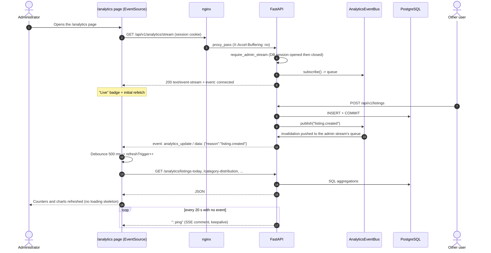

# Database schema

The complete PostgreSQL schema of **Le Bon 42**, with every column. The models
live in [`backend/src/app/models/`](backend/src/app/models/) and the schema is
created by the Alembic migration in
[`backend/migrations/versions/`](backend/migrations/versions/). The conventions
(keys, soft deletes, `CHECK` constraints, lookup tables) are explained in the
[back-end README](backend/README.md#database).

## Entity-relationship diagram

Reading the cardinality markers ([Mermaid syntax](https://mermaid.js.org/syntax/entityRelationshipDiagram.html)):
the outer character of each marker is the maximum, the inner one the minimum.

| Left | Right | Meaning |
|---|---|---|
| `\|o` | `o\|` | Zero or one |
| `\|\|` | `\|\|` | Exactly one |
| `}o` | `o{` | Zero or more |
| `}\|` | `\|{` | One or more |

```mermaid
---
title: Le Bon 42
config:
    layout: elk
---
erDiagram



direction TB

	locations ||--o{ users : lives_in
	roles ||--o{ users : has_role
	roles {
		text id PK "user, moderator, admin - editable without a migration"
		text label "human-readable label"
	}

	users {
		bigint id PK
		uuid public_id UK
		citext email UK "case insensitive"
		text password_hash "null for OAuth-only"
		text display_name "case insensitive"
		text role "REFERENCES roles(id)"
		text bio
		boolean is_active
		text avatar_path
		bigint location_id "REFERENCES locations(id)"
		text locale "DEFAULT fr"
		text totp_secret_encrypted "null until enrolled (for 2FA)"
		boolean totp_enabled "DEFAULT false"
		bigint rating "sum of the ratings received"
		int rating_count "number of ratings received"
		timestamptz email_verified_at
		timestamptz deleted_at
		timestamptz created_at "DEFAULT now()"
		timestamptz updated_at "DEFAULT now() - no trigger: set by PATCH /users/me and POST /api/auth/password"
	}

	users ||--o{ oauth_accounts : has
	oauth_accounts {
		bigint id PK
		text provider
		text provider_account_id
		bigint user_id FK
		timestamptz created_at
	}

	users ||--o{ user_blocks : blocks
	user_blocks {
		bigint user_blocking FK "REFERENCES users(id)"
		bigint user_blocked FK "REFERENCES users(id)"
		timestamptz created_at
	}

	users ||--o{ friends : has
	friends {
		bigint id PK
		bigint requester_id FK "REFERENCES users(id)"
		bigint address_id FK "REFERENCES users(id)"
		text status "CHECK pending, accepted, declined, blocked - the API uses pending and accepted; DEFAULT pending"
		timestamptz created_at
		timestamptz responded_at
	}

	users ||--o{ friends_messages : sends
	friends ||--o{ friends_messages : contains
	friends_messages {
		bigint id PK
		bigint conversation_id "REFERENCES friends(id)"
		bigint sender_id "REFERENCES users(id)"
		text body
		timestamptz created_at "not partitioned by date - this project's chat volume doesn't warrant the maintenance cost"
		timestamptz edited_at
		timestamptz deleted_at
	}

	categories ||--o{ categories : parent_of
	categories {
		bigint id PK
		bigint parent_id "REFERENCES categories(id)"
		smallint depth
		text category_name
		boolean is_leaf
	}

	categories ||--o{ category_attributes : defines
	category_attributes {
		bigint id PK
		bigint category_id "REFERENCES categories(id)"
		text key "e.g. number of m2 for an apartment"
		text data_type "int, dec, bool, enum, text, date..."
		text unit "m2, km, etc"
		boolean is_required
		boolean is_filterable
		jsonb options
	}

	users ||--o{ listings : posts
	users ||--o{ listings : bought
	categories ||--o{ listings : classifies
	locations ||--o{ listings : located_at
	listing_conditions ||--o{ listings : has_condition
	listing_conditions {
		text id PK "new, like_new, good, fair, for_parts - editable without a migration"
		text label "human-readable label"
	}

	listings {
		bigint id PK
		uuid public_id "NOT NULL UNIQUE"
		bigint seller_id "NOT NULL REFERENCES users(id)"
		bigint buyer_id "REFERENCES users(id), nullable - must differ from seller_id"
		bigint category_id "REFERENCES categories(id)"
		text title
		text body
		bigint price
		char(3) currency "DEFAULT 'EUR'"
		text condition "REFERENCES listing_conditions(id), nullable - services/carpooling/lessons have none"
		jsonb attributes
		bigint location_id "REFERENCES locations(id)"
		text status "draft, active, sold, expired, archived, deleted, DEFAULT draft"
		timestamptz published_at
		timestamptz expires_at
		bigint cover_image_id "REFERENCES listing_images(id)"
		bigint view_count
		tsvector search_vector "kept in sync by a trigger on title/body - Postgres FTS is the search backend; no transactional outbox/worker needed at this scale"
		timestamptz created_at "DEFAULT now()"
		timestamptz updated_at
		timestamptz deleted_at
	}

	locations {
		bigint id PK
		text location UK "42 Paris, 42 Lyon,..."
	}

	listings ||--o{ listing_images : shows
	listing_images {
		bigint id PK
		bigint listing_id "REFERENCES listings(id)"
		text storage_path
		int position
		int width
		int height
		bigint phash "64-bit perceptual hash (dHash/pHash), detects duplicate/scam reposts"
		timestamptz created_at
	}

	users ||--o{ listing_favorites : saves
	listings ||--o{ listing_favorites : favorited_in
	listing_favorites {
		bigint user_id PK "REFERENCES users(id)"
		bigint listing_id PK "REFERENCES listings(id)"
		timestamptz created_at "DEFAULT now"
	}

	users ||--o{ saved_searches : subscribes
	saved_searches {
		bigint id PK
		bigint user_id "REFERENCES users(id)"
		text search_name
		jsonb criteria
		timestamptz created_at
	}

	listings ||--o{ conversations : discussed_in
	users ||--o{ conversations : sells_in
	users ||--o{ conversations : buys_in
	conversations {
		bigint id PK
		bigint listing_id FK "REFERENCES listings(id)"
		bigint seller_id FK "REFERENCES users(id)"
		bigint buyer_id FK "REFERENCES users(id)"
		boolean closed
		timestamptz created_at
	}

	users ||--o{ messages : sends
	conversations ||--o{ messages : contains
	messages {
		bigint id PK
		bigint conversation_id "REFERENCES conversations(id)"
		bigint sender_id "REFERENCES users(id)"
		text body
		timestamptz created_at "not partitioned by date - this project's chat volume doesn't warrant the maintenance cost"
		timestamptz edited_at
		timestamptz deleted_at
	}

	users ||--o{ reviews : writes
	users ||--o{ reviews : receives
	conversations ||--o{ reviews : reviewed_after
	reviews {
		bigint id PK
		bigint conversation_id "REFERENCES conversations(id)"
		bigint author_id "REFERENCES users(id)"
		bigint subject_id "REFERENCES users(id)"
		smallint rating
		text body
		timestamptz created_at
		timestamptz edited_at
		timestamptz deleted_at
	}

	users ||--o{ reports : writes
	report_target_types ||--o{ reports : has_target_type
	report_target_types {
		text id PK "listing, message, user, review - editable without a migration"
		text label "human-readable label"
	}

	reports {
		bigint id PK
		bigint reporter_id "REFERENCES users(id)"
		text target_type "REFERENCES report_target_types(id)"
		bigint target_id
		text reason
		text status "open, in_progress, resolved, closed, DEFAULT open"
		timestamptz created_at
		timestamptz closed_at
	}


```

---

## SSE Architecture

